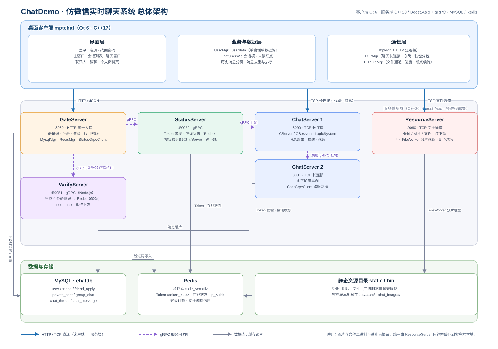
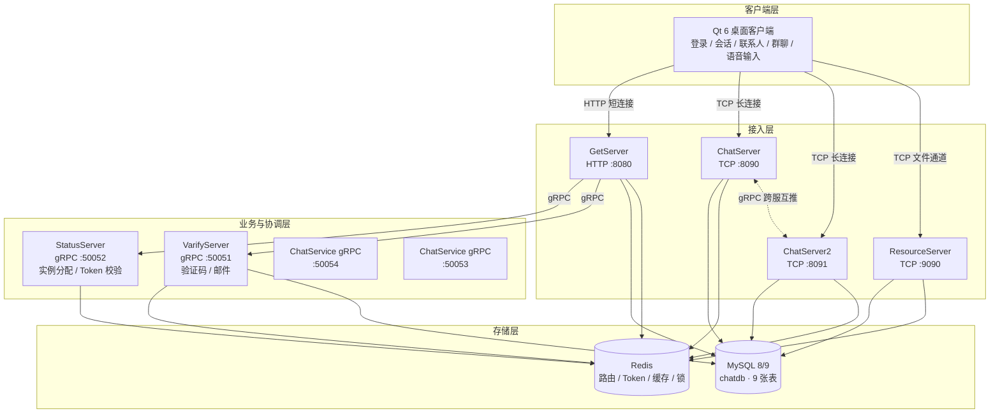
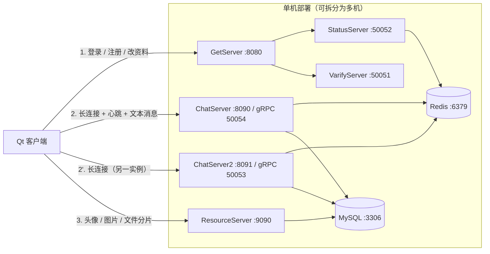
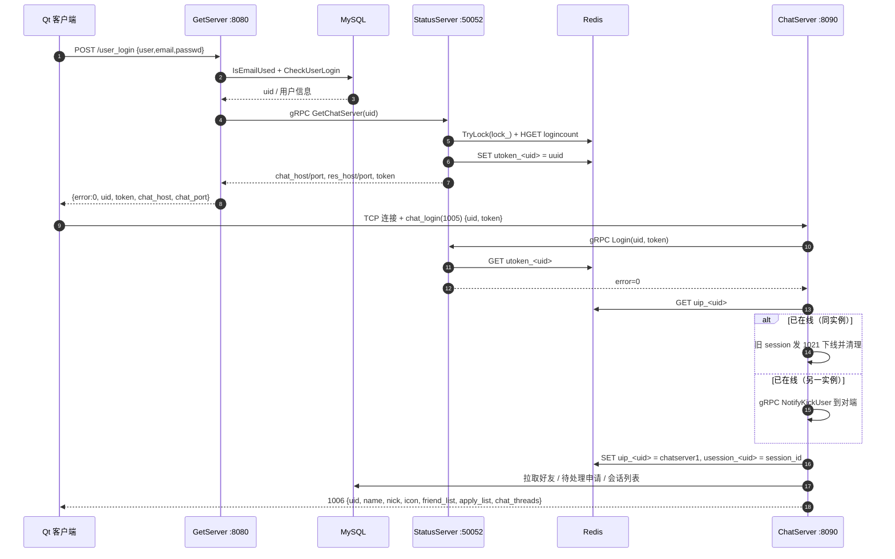
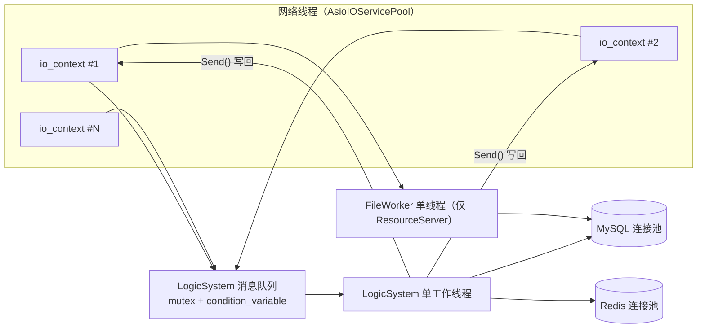
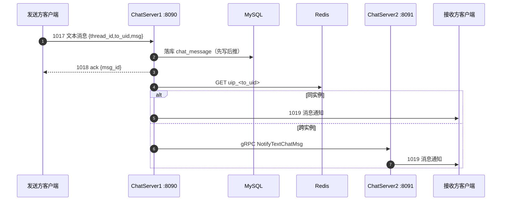
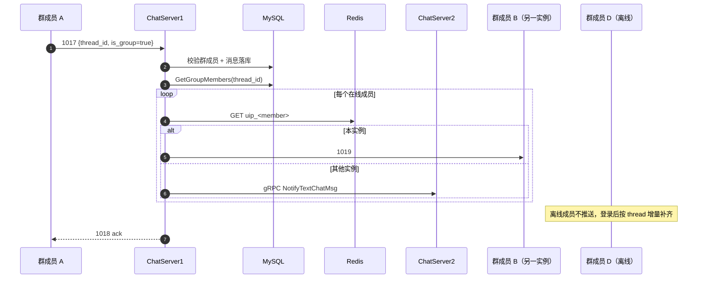
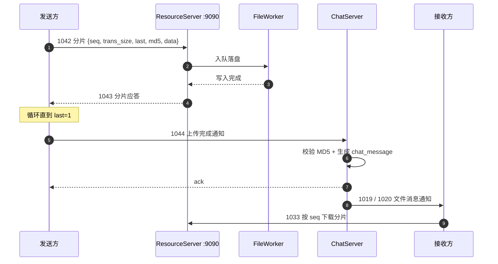

# ChatDemo 系统架构设计文档

| 项 | 内容 |
| --- | --- |
| 文档名称 | ChatDemo 分布式即时通讯系统 · 系统架构设计 |
| 版本 | v1.0 |
| 日期 | 2026-11-24 |
| 对应代码 | `mptchat` 仓库 `main` 分支 |
| 读者 | 后端 / 客户端开发、测试、面试评审 |
| 关联文档 | [`README.md`](../README.md)、[`db/schema.sql`](../db/schema.sql)、[`db/README.md`](../db/README.md)、[`bench/chat_stress.py`](../bench/chat_stress.py) |

---

## 目录

1. [文档目的与范围](#1-文档目的与范围)
2. [系统概述](#2-系统概述)
3. [总体架构](#3-总体架构)
4. [服务设计](#4-服务设计)
5. [通信设计](#5-通信设计)
6. [并发与线程模型](#6-并发与线程模型)
7. [数据设计](#7-数据设计)
8. [关键业务流程](#8-关键业务流程)
9. [可靠性设计](#9-可靠性设计)
10. [性能与容量](#10-性能与容量)
11. [安全设计](#11-安全设计)
12. [构建、测试与发布](#12-构建测试与发布)
13. [已知限制与演进方向](#13-已知限制与演进方向)
14. [附录](#14-附录)

---

## 1. 文档目的与范围

### 1.1 目的

本文描述 ChatDemo 的总体架构、服务边界、通信协议、并发模型、数据模型与关键流程，用于：

- 作为开发与维护的统一参考，避免「代码这么写但没人知道为什么」；
- 作为性能压测、故障排查时的分析依据；
- 作为面试/评审时说明技术选型与取舍的材料。

### 1.2 范围

覆盖服务端 5 个进程（GetServer、StatusServer、ChatServer、ChatServer2、ResourceServer）、
Node.js 验证码服务、Qt 6 客户端、MySQL / Redis 两类存储，以及 CI/Release 流水线。

不覆盖：产品需求文档、UI 视觉规范、第三方库内部实现。

### 1.3 术语

| 术语 | 含义 |
| --- | --- |
| `uid` | 用户唯一 id（MySQL `user.id`） |
| `thread_id` | 会话 id，单聊/群聊共用一张 `chat_thread` 表 |
| `CSession` | 一条 TCP 长连接的服务端对象，持有 socket、接收缓冲与发送队列 |
| Reactor | 事件循环，把 socket 可读/可写事件分发给回调；本项目用 Boost.Asio 的 `io_context` |
| 多 Reactor | 多个 `io_context` 各跑一个线程，连接按轮转方式分摊 |
| `uip_<uid>` | Redis 中记录「该用户当前连在哪个 ChatServer 实例」的路由键 |
| 扇出（fan-out） | 一条群消息按成员列表逐个投递 |

---

## 2. 系统概述

### 2.1 定位

ChatDemo 是一套自研的桌面即时通讯系统，覆盖「账号 → 好友 → 实时单聊 → 图片/文件传输 → 群聊」全链路。
通信协议、消息分发、在线路由、文件分片传输均为自研，未使用现成 IM 框架。

### 2.2 设计目标

| 目标 | 落地方式 |
| --- | --- |
| 高并发接入 | Boost.Asio 多 Reactor + 工作线程池，单实例承载上千并发长连接，多实例横向扩展 |
| 消息不丢、不重、不乱序 | 落库 + 发送 ack + 客户端按 `msg_id` 去重排序，离线消息增量补齐 |
| 协议自研可控 | 二进制帧：`msg_id(2B) + len(2B) + JSON body` |
| 多媒体可靠传输 | 独立 ResourceServer，分片上传 + MD5 校验 + 断点续传 |
| 可扩展可运维 | ChatServer 无状态化，Redis 维护在线路由，配置外置，心跳保活 |
| 好友与群管理 | 申请/拒绝/删除好友双向生效；群成员可邀请、仅群主可踢人；跨服操作经 gRPC 通知 |

### 2.3 能力边界

- 不含语音/视频通话、朋友圈、支付、移动端与 Web 端；
- 客户端内置端侧语音转文字（sherpa-onnx），产出的是文本消息，不是语音消息；
- 当前部署为单机多进程，跨机部署已验证协议但未做跨机网络调优。

---

## 3. 总体架构

### 3.1 逻辑分层





### 3.2 部署拓扑



要点：

- **ChatServer 无状态**：在线状态与路由放在 Redis，进程重启不影响数据正确性，只影响在线连接；
- **水平扩展**：新增 `chatserver3` 只需在 StatusServer 的 `[chatservers]` 与各 ChatServer 的 `[PeerServer]` 中登记；
- **StatusServer 是分配中心**，不转发消息，只回答「这个用户该连哪台」并签发 token。

### 3.3 服务清单

| 服务 | 进程形态 | 对外协议 / 端口 | 核心职责 | 主要依赖 |
| --- | --- | --- | --- | --- |
| GetServer | 单线程 HTTP 服务 | HTTP :8080（Beast） | 注册、登录、改密、资料更新、拉取验证码 | MySQL、Redis、StatusServer、VarifyServer |
| StatusServer | gRPC 服务 | gRPC :50052 | 实例分配（当前在线数最少）、token 签发与校验 | Redis |
| ChatServer | 多 Reactor + gRPC | TCP :8090、gRPC :50054 | 长连接、心跳、单聊/群聊、好友与群成员管理 | MySQL、Redis、StatusServer、Peer ChatServer |
| ChatServer2 | 同上 | TCP :8091、gRPC :50053 | 与 ChatServer 同一份代码的第二实例 | 同上 |
| ResourceServer | 多 Reactor + 文件线程 | TCP :9090 | 头像、图片、文件分片上传下载 | MySQL、Redis |
| VarifyServer | Node.js | gRPC :50051 | 生成验证码、发邮件、写 Redis | Redis、SMTP |
| MySQL | 数据库 | :3306 | 账号、好友、会话、消息、群成员 | — |
| Redis | 缓存/协调 | :6379 | token、在线路由、用户缓存、分布式锁、验证码 | — |

### 3.4 关键架构决策

| 决策 | 选择 | 理由 | 代价 |
| --- | --- | --- | --- |
| 服务拆分 | 网关 / 状态 / 聊天 / 资源 / 验证码 5 个服务 | 职责单一，可独立扩容；聊天与文件 IO 特征差异大 | 部署与调试成本上升，需要服务发现 |
| 传输协议 | 自定义二进制帧 + JSON body | 头部固定 4 字节，解析简单；JSON 便于扩展字段 | 比 Protobuf 体积大，需自己做兼容 |
| 服务间通信 | gRPC + Protobuf | 强类型、自带超时/连接复用、跨语言 | 需要维护 `.proto` 与生成代码 |
| 在线路由 | Redis `uip_<uid>` | 多实例共享，读写 O(1) | 依赖 Redis 可用性 |
| 并发模型 | 多 Reactor + 单逻辑线程 | 网络 IO 并行，业务串行免锁；实现简单、易排查 | 单逻辑线程是吞吐上限，重业务需再分片 |
| 消息可靠性 | 先落库再推送 + ack + 客户端去重 | 保证不丢、不重、不乱序 | 写库在关键路径上，延迟受 MySQL 影响 |
---

## 4. 服务设计

### 4.1 GetServer（HTTP 网关）

**线程模型**：`boost::asio::io_context ioc{1}` + Boost.Beast，单线程事件循环；
处理函数内直接访问 MySQL/Redis，因此它只承担短请求，不承担长连接。

**接口清单**（全部为 `POST`，请求体 JSON）：

| 路径 | 作用 | 关键依赖 |
| --- | --- | --- |
| `/get_varifycode` | 请求邮箱验证码 | VarifyServer → Redis `code_<email>` |
| `/user_register` | 注册（校验验证码、用户名/邮箱唯一） | Redis、MySQL |
| `/reset_pwd` | 通过验证码重置密码 | Redis、MySQL |
| `/user_login` | 登录：校验账号密码 → 分配 ChatServer → 签发 token | MySQL、StatusServer |
| `/user_update_info` | 修改昵称 / 性别 / 头像等（校验 token） | Redis `utoken_<uid>`、MySQL |

**登录返回结构**：

```json
{
  "error": 0,
  "user": "user1",
  "uid": 2,
  "token": "3f1c...uuid",
  "chat_host": "127.0.0.1",
  "chat_port": "8090",
  "res_host": "127.0.0.1",
  "res_port": "9090"
}
```

设计说明：

- 网关**不缓存** token，签发与校验都统一交给 StatusServer，避免两处逻辑漂移；
- 修改资料时额外比一次 Redis 里的 `utoken_<uid>`，防止拿到旧 token 改别人资料。

### 4.2 StatusServer（状态与分配）

**接口**：

| gRPC 方法 | 入参 | 出参 | 作用 |
| --- | --- | --- | --- |
| `GetChatServer` | `uid` | `chat_host/chat_port/res_host/res_port/token` | 选一个在线数最少的 ChatServer，生成 UUID token 写入 Redis |
| `Login` | `uid` + `token` | `error` | 校验 token 是否与 Redis `utoken_<uid>` 一致 |

**分配算法**：

```text
TryLock("lock_", 30s)              // Redis SET NX EX + Lua，防止多登录并发时选出同一实例
  ├─ 读 HGET logincount <每个实例>  // ChatServer 每 60s 上报一次在线连接数
  ├─ 取最小值
  └─ Unlock
失败 → 返回 RPCFailed，由网关转成 1010
```

说明与取舍：

- 分配依据是**长连接数**，不是 CPU/内存，因此短连接风暴下会出现「都读到 0，全压在同一个实例」的现象
  （压测 7.2 已复现）。长连接场景下分布正常（1000 连接时 600/400）。
- 没有引入注册中心，实例列表来自 `config.ini` 的 `[chatservers]`，属于静态配置 + 运行时计数。

### 4.3 ChatServer / ChatServer2（长连接与业务）

**组成**：

| 模块 | 职责 |
| --- | --- |
| `CServer` | accept 新连接、维护 `session_id → CSession` 表、60s 定时扫描过期会话 |
| `CSession` | 单连接读写：粘包拆包、发送队列、心跳时间戳、异常清理 |
| `LogicSystem` | 单线程消息循环，按 `msg_id` 分发到 19 个回调；业务主体 |
| `UserMgr` | 内存中的 `uid → CSession` 映射，仅本进程有效 |
| `MysqlMgr` | 连接池 + 业务 SQL（好友、会话、消息、群成员） |
| `RedisMgr` | token、路由、用户缓存、分布式锁（Lua 脚本） |
| `ChatGrpcClient` | 向对端 ChatServer 发起 gRPC 调用（跨服推送） |
| `ChatServiceImpl` | 接收对端 gRPC 调用，转发给本机 session |

**两个实例的关系**：

- 代码完全一致，仅 `config.ini` 的 `[SelfServer]`（Name/Port/RPCPort）不同；
- 通过 `[PeerServer] Servers = chatserver2` 互相登记，用于跨服推送；
- CI 中有 `sync` job 逐字节比对 12 个共享源文件，防止只改一边。

### 4.4 ResourceServer（文件与头像）

**职责**：头像上传、图片/文件分片上传、下载、断点续传。

| 消息 id | 方向 | 作用 |
| --- | --- | --- |
| `1031/1032` | 客户端 → 服务端 | 上传头像 |
| `1033/1034` | 客户端 → 服务端 | 下载文件（按 `seq` 分片） |
| `1037/1038` | 客户端 → 服务端 | 图片分片上传 |
| `1042/1043` | 客户端 → 服务端 | 文件分片上传 |

**关键设计**：

- 网络线程只做收发，落盘交给 `FileWorker` 单线程队列，避免磁盘 IO 阻塞 Reactor；
- 每个分片带 `seq`、`trans_size`、`last`、`md5`；
- 上传完成后由 ChatServer 侧发送 `1039`（图片）/`1044`（文件）完成通知，再生成聊天消息。

### 4.5 VarifyServer（验证码）

- Node.js + `@grpc/grpc-js`，监听 `:50051`；
- 验证码写入 Redis `code_<email>`，TTL 600s，重复请求复用未过期验证码；
- 通过 nodemailer 发信，失败时返回错误码由网关透传。

---

## 5. 通信设计

### 5.1 客户端 ↔ 服务端：二进制帧

```text
+----------+----------+-------------------+
| msg_id   | length   | body (JSON UTF-8) |
| 2 bytes  | 2 bytes  | length bytes      |
| 大端      | 大端      |                   |
+----------+----------+-------------------+
```

| 常量 | 值 | 说明 |
| --- | --- | --- |
| `HEAD_TOTAL_LEN` | 4 | 头部总长 |
| `HEAD_ID_LEN` | 2 | msg_id 长度 |
| `HEAD_DATA_LEN` | 2 | 包体长度字段 |
| `MAX_LENGTH` | 2048 | 单帧最大包体 |
| `MAX_RECVQUE` | 10000 | 接收队列上限 |
| `MAX_SENDQUE` | 1000 | 发送队列上限（超限视为异常连接） |

**粘包/半包处理**：`CSession::AsyncReadHead` 先读固定 4 字节，解析出长度后再 `AsyncReadBody` 读满；
不足则继续等待，不会把两次 send 拼成一条消息，也不会把一条消息拆错。

**为什么不用纯文本/HTTP**：长连接下每帧都要带完整 header（HTTP 头通常几百字节），
二进制 4 字节头 + JSON 在调试便利性与开销之间取平衡。

### 5.2 消息 id 规划

| 区间 | 用途 |
| --- | --- |
| 1005 ~ 1030 | 登录、搜索、好友申请、单聊、心跳、会话与消息加载 |
| 1031 ~ 1044 | 头像、下载、图片/文件分片上传 |
| 1045 ~ 1047 | 建群与建群通知 |
| 1050 ~ 1051 | 清空会话聊天记录 |
| 1060 ~ 1067 | 删除好友、邀请入群、踢人、拒绝好友申请 |
| 1068 ~ 1070 | 服务端单向通知：好友删除、群成员变化、被踢出群 |

完整定义见 [`ChatServer/const.h`](../ChatServer/const.h)。

### 5.3 服务间 gRPC 接口

**StatusService**（StatusServer 提供，GetServer / ChatServer 调用）：

| 方法 | 用途 |
| --- | --- |
| `GetChatServer` | 分配实例 + 签发 token |
| `Login` | 长连接握手时二次校验 token |

**ChatService**（每个 ChatServer 都提供，供对端调用）：

| 方法 | 触发场景 |
| --- | --- |
| `NotifyAddFriend` | 好友申请跨服推送 |
| `NotifyAuthFriend` | 同意好友申请跨服推送 |
| `NotifyTextChatMsg` | 文本消息跨服推送 |
| `NotifyImageChatMsg` | 图片消息跨服推送 |
| `NotifyKickUser` | 重复登录时踢掉另一实例上的旧连接 |
| `NotifyAddGroupChat` | 建群通知推给群成员 |
| `NotifyFriendDeleted` | 删除好友后通知对方 |
| `NotifyGroupMembersChanged` | 邀请入群后广播成员列表 |
| `NotifyGroupKicked` | 踢人后通知被踢者 |

### 5.4 错误码

| 码 | 名称 | 含义 |
| --- | --- | --- |
| 0 | `Success` | 成功 |
| 1001 | `Error_Json` | JSON 解析失败 |
| 1002 | `RPCFailed` | gRPC 调用失败 |
| 1003 / 1004 | `VarifyExpired` / `VarifyCodeErr` | 验证码过期 / 错误 |
| 1005 / 1006 | `UserAlreadyExist` / `RegisterFailed` | 注册冲突 / 失败 |
| 1007 / 1008 / 1009 | `UserNotExist` / `ModifyPassErr` / `ModifyLoginErr` | 用户不存在 / 改密失败 / 密码错误 |
| 1010 | `RPCGetFailed` | 取不到可用 ChatServer |
| 1011 / 1012 | `UidInvalid` / `TokenInvalid` | uid 无效 / token 无效 |
| 1013 ~ 1016 | `CREATE_CHAT_FAILED` 等 | 会话/群创建、加载、清空失败 |
| 1017 ~ 1019 | `FRIEND_NOT_EXIST` / `FRIEND_APPLY_NOT_EXIST` / `GROUP_NOT_EXIST` | 好友/申请/群不存在 |
| 1020 | `GROUP_NO_PERMISSION` | 非群主执行管理操作 |
| 1021 | `GROUP_MEMBER_NOT_EXIST` | 目标不是群成员 |
| 1022 | `GROUP_OWNER_CANNOT_KICK` | 群主不能踢自己 |

### 5.5 登录时序



登录阶段共 3 跳（HTTP → gRPC → TCP），压测中 p99 在 0.9s 以内（1000 并发）。
---

## 6. 并发与线程模型

### 6.1 线程结构



| 线程 | 数量 | 职责 | 关键约束 |
| --- | --- | --- | --- |
| 主线程 | 1 | accept、60s 定时器、信号处理 | 不执行业务 |
| IO 线程 | `hardware_concurrency()` | 每个 `io_context` 一个线程，负责 `async_read/async_write` | 新连接**轮转**分配，避免单线程打满 |
| 逻辑线程 | 1 | 消费消息队列，执行 `msg_id` 回调 | 业务串行，无共享状态竞争 |
| 文件线程 | 1（仅 ResourceServer） | 落盘、校验、读取 | 磁盘 IO 不阻塞网络线程 |
| gRPC 线程 | 1（每进程） | `server->Wait()` | 回调中只做推送与转发 |

### 6.2 为什么这样分

- **网络线程并行**解决 C10K 的 IO 多路复用问题；
- **业务单线程**把「锁」的成本降到零：好友、会话、群成员的读写都在同一线程内完成，
  不需要给 `UserMgr`、`MysqlMgr` 的调用点加锁（内部连接池自身加锁）；
- 代价是**单逻辑线程是吞吐上限**。实测心跳 17k~19k 次/s，文本消息端到端约 600 次/s
  （瓶颈在压测端的同步往返），仍有余量。若继续增长，按 `thread_id` 哈希分片即可平滑扩展。

### 6.3 发送队列与背压

- 每个 `CSession` 有一条 `std::queue<SendNode>` + `_send_mutex`；
- `Send()` 入队后若队列原本为空，则发起一次 `async_write`，写完再取下一个；
- 队列超过 `MAX_SENDQUE`（1000）视为异常连接，直接关闭，防止慢客户端拖垮内存。

### 6.4 心跳与会话回收

- 客户端每 5s 发一次 `1023`，服务端回 `1024` 并刷新 `_last_heartbeat`；
- 主线程 60s 定时扫描：`now - last_heartbeat > 60` 判定掉线；
- 清理时先抢 `lock_<uid>`，再比对 `usession_<uid>`：
  - 若 Redis 里的 session_id 已不是自己（用户已在新连接上），只清理本机 session，不动路由；
  - 若一致，才删除 `uip_<uid>` 与 `usession_<uid>`，避免「旧连接的清理把新连接的路由删掉」。

---

## 7. 数据设计

### 7.1 MySQL（chatdb，9 张表）

| 分组 | 表 | 作用 | 关键索引 |
| --- | --- | --- | --- |
| 账号 | `user` | 账号、昵称、密码、头像、性别、签名 | `pk(id)`、`uk(name)`、`uk(email)` |
| 好友 | `friend` | 好友关系（双向各一行） | `pk(id)`、`idx(user_id)`、`idx(friend_id)` |
| 好友 | `friend_apply` | 好友申请与状态（0 待处理 / 1 通过 / 2 拒绝） | `idx(from_uid,to_uid)` |
| 会话 | `chat_thread` | 会话索引（单聊/群聊），会话列表来源 | `pk(id)` |
| 会话 | `private_chat` | 单聊参与者映射 | `pk(thread_id,user_id)` |
| 会话 | `group_chat` | 群信息（群主、群名） | `pk(thread_id)` |
| 会话 | `group_chat_member` | 群成员 | `pk(thread_id,user_id)`、`idx(user_id)` |
| 消息 | `chat_message` | 文本/图片/文件消息明细 | `pk(message_id)`、`idx(thread_id,created_at)` |
| 消息 | `chat_clear_history` | 每个用户在每个会话已清空到的 `message_id` 水位 | `pk(user_id,thread_id)` |

设计说明：

- 单聊与群聊共用 `chat_thread`，用 `thread_type` 区分，客户端只需一套会话列表逻辑；
- `chat_message` 以 `thread_id + message_id` 递增，客户端按 `msg_id` 排序与去重；
- 清空记录**不做物理删除**，只写水位，保证对方视角不受影响、也便于审计。

### 7.2 Redis key 规范

| Key | 类型 | 写入时机 | 作用 |
| --- | --- | --- | --- |
| `utoken_<uid>` | string | 登录（StatusServer） | 会话 token，长连接握手与改资料时校验 |
| `uip_<uid>` | string | 长连接登录成功 | 该用户所在 ChatServer 名（如 `chatserver1`），跨服路由依据 |
| `usession_<uid>` | string | 长连接登录成功 | 当前有效 session uuid，用于防旧连接误删路由 |
| `ubaseinfo_<uid>` | string(JSON) | 首次读取后回填 | 用户基础信息缓存（Cache-Aside） |
| `nameinfo_<name>` | string(JSON) | 按用户名查询后回填 | 用户名 → 用户信息缓存 |
| `logincount` | hash | ChatServer 每 60s 上报 | `实例名 → 在线连接数`，StatusServer 据此分配 |
| `lock_` / `lock_<uid>` | string | 分配实例 / 登录 / 清理会话 | 分布式锁，`SET NX EX` + Lua 释放 |
| `code_<email>` | string | 请求验证码 | 6 位验证码，TTL 600s |

### 7.3 缓存一致性

- 用户信息采用 **Cache-Aside**：先读 Redis，未命中查 MySQL 并回填，读多写少；
- 资料修改后由 `GetServer` 直接更新 MySQL，并删除/覆盖对应缓存 key（下次读回源）；
- 在线路由不设 TTL，靠「登录覆盖 + 会话过期清理 + 重复登录踢人」三条路径保证最终正确。

---

## 8. 关键业务流程

### 8.1 单聊（同服 / 跨服）



要点：

- **先落库后推送**：ack 返回时消息已持久化，客户端可以放心标记已发送；
- 接收方离线则只落库，登录时通过 `1029` 按 `thread_id` 增量拉取；
- 跨服推送不落第二份库，避免重复消息。

### 8.2 群聊扇出



设计取舍：扇出在**发送方所在实例**完成，逻辑集中、无需消息队列；
代价是群成员极多时单条消息的同步开销线性增长，当前定位是中小规模群。

### 8.3 好友与群成员管理

**好友**

| 操作 | 协议 | 服务端行为 | 通知 |
| --- | --- | --- | --- |
| 申请 | `1009` / `1010` | 写 `friend_apply`（重复申请重置为待处理） | 对方在线收 `1011` |
| 同意 | `1013` / `1014` | 置 `status=1`，双向写 `friend` | 对方收 `1015`，双方刷新列表 |
| 拒绝 | `1066` / `1067` | 置 `status=2`，列表过滤 | 无（对方不感知，可重新申请） |
| 删除 | `1060` / `1061` | 双向删除 `friend`，**保留聊天记录** | 对方收 `1068`，客户端移除联系人/会话 |

**群成员**

| 操作 | 协议 | 权限 | 服务端行为 | 通知 |
| --- | --- | --- | --- | --- |
| 邀请入群 | `1062` / `1063` | 任意群成员 | 校验邀请人在群内 → 事务 + `INSERT IGNORE` → 返回真正新增的人 | 在线成员收 `1069`（含新成员列表与 `owner_uid`） |
| 踢人 | `1064` / `1065` | **仅群主** | 校验 `owner_uid == 当前 uid`；不能踢自己、不能踢其他管理员 | 被踢者收 `1070`；其余成员收 `1069` |

权限判定不使用 `role > 0`，而是直接比对 `group_chat.owner_uid`，避免角色字段被误配后越权。

### 8.4 图片 / 文件传输



- 分片大小与并发由客户端控制，服务端按 `seq` 顺序写，支持断点续传（已存在的分片跳过）；
- MD5 在客户端算、服务端校验，避免网络损坏；
- 图片与文件走同一套分片机制，只是消息类型不同（`MSG_TYPE_IMG` / `MSG_TYPE_FILE`）。

### 8.5 清空聊天记录

- 请求 `1050`，服务端写 `chat_clear_history(user_id, thread_id, cleared_before)`；
- 拉取消息（`1029`）时带上 `message_id > cleared_before` 条件；
- **只影响操作者本人**：对方消息、数据库原始记录都不动，符合「本地清空」的产品语义；
- 用 `INSERT ... ON DUPLICATE KEY UPDATE` 保证重复清空幂等。

### 8.6 重复登录与强制下线

1. 新连接握手时读 `uip_<uid>`；
2. 若已有连接且在同一实例：直接对旧 session 发 `1021` 并清理；
3. 若在另一实例：调用 `NotifyKickUser`，由对端推送 `1021` 并清理；
4. 新连接覆盖 `uip_<uid>` 与 `usession_<uid>`。

整个过程用 `lock_<uid>` 串行化，避免两个连接同时判定「对方是旧的」。
---

## 9. 可靠性设计

| 风险 | 应对 | 代码位置 |
| --- | --- | --- |
| 消息丢失 | 先落库再 ack；发送方收到 `1018` 才认为成功 | `ChatServer/LogicSystem.cpp` 文本消息回调 |
| 消息重复 | 客户端按 `msg_id` 去重；服务端不重复落库 | 客户端 `chatpage.cpp` / 数据模型 |
| 消息乱序 | 按 `msg_id` 单调排序渲染，时间只做展示 | 客户端会话模型 |
| 对方离线 | 只落库，登录后 `1029` 按 `thread_id` 增量拉取 | `ID_LOAD_CHAT_MSG_REQ` |
| 重复登录 | `lock_<uid>` + `uip_<uid>` + `usession_<uid>` 三件套 | `LogicSystem` 登录回调、`CSession::DealExceptionSession` |
| 并发拉人 | 事务 + `INSERT IGNORE`，只广播真正新增的成员 | `MysqlMgr::AddGroupMembers` |
| 越权踢人 | 比对 `group_chat.owner_uid`，不使用角色字段 | `LogicSystem` 踢人回调 |
| 会话泄漏 | 60s 定时扫描心跳超时并清理 | `CServer::on_timer` |
| 慢客户端 | 发送队列上限 1000，超限断开 | `CSession::Send` |
| gRPC 失败 | 返回错误码，调用方不阻塞主流程（离线消息仍可拉取） | `ChatGrpcClient` |

**未做（已知）**：没有分布式事务，好友关系与申请状态分两条 SQL 写入，
极端情况下（进程在两条 SQL 之间崩溃）可能出现单向好友，需要靠定时对账修复。

---

## 10. 性能与容量

测试环境：i9-13900HX / 32GB / Windows 11，客户端与服务端同机（localhost），
MSVC Release，MySQL 9.3 + Redis 5.0 本机。完整表格见 README 第七章。

### 10.1 关键指标

| 场景 | 规模 | 结果 | 资源 |
| --- | --- | --- | --- |
| 并发登录（HTTP→gRPC→TCP 三跳） | 1000 | 1000/1000 成功，1.17s，859 次/s，p99 853ms | 两实例分布 673 / 327 |
| TCP 建连风暴 | 2000 | 100% 成功，0.58s | — |
| 长连接 + 心跳（60s，5s 一次） | 1000 | 12000 次心跳 0 错误 0 掉线，p99 31.8ms | 两实例合计 CPU 2.3%，RSS 60.5MB |
| 文本消息（32B） | 20s 连发 | 12,233 条，0 丢包，ack p99 2.82ms | 压测端单线程上限约 620 次/s |
| 跨服消息 | 双向各 1 条 | ack 0.01s，error=0，对端均收到 | — |

### 10.2 瓶颈分析

1. **日志是最大热点**：心跳里 `std::cout << ... << std::endl` 每行强制刷新，
   实测 17.3k 次/s；重定向到 NUL 后 19.5k 次/s，差 1.13 倍。
   早期测得的 9.6 倍无法复现，已修正结论（控制变量实验，重复三轮）。
2. **单逻辑线程**：业务串行，理论吞吐上限取决于单次处理耗时；
   当前心跳余量约 20 倍，文本消息余量受压测端限制，尚未触顶。
3. **实例分配偏差**：短连接风暴下所有请求读到相同的在线数，会集中到同一实例；
   长连接场景分布正常。
4. **同机压测**：客户端、MySQL、Redis 与服务端抢同一份 CPU，数据只能横向比较。

### 10.3 容量估算

按实测 1000 长连接占用 2.3% 单核、60MB 内存估算，
单实例在 8 核机器上连接数不是瓶颈，瓶颈会先出现在业务线程与数据库写入；
生产环境建议按「单实例 5k~10k 长连接」规划，并提前把消息写入改为批量/异步。

---

## 11. 安全设计

| 面向 | 措施 |
| --- | --- |
| 身份认证 | 登录签发 UUID token，长连接握手与改资料均二次校验 |
| 会话唯一 | `usession_<uid>` + 分布式锁，旧连接无法覆盖新连接状态 |
| SQL 注入 | 全部使用 `mysql_stmt_prepare` 参数化查询 |
| 越权 | 好友操作校验关系存在；群管理校验 `owner_uid`；资源下载校验归属 |
| 传输完整性 | 文件/图片分片带 MD5，服务端校验后才入库 |
| 输入健壮性 | JSON 解析异常统一捕获返回 `1001`；`json.value()` 提供默认值 |
| 验证码 | Redis TTL 600s，注册/改密前校验 |

**已知不足（生产化必须补）**：

- 密码当前明文存储，应改为 bcrypt / Argon2 + 盐；
- 全链路无 TLS，token 与消息在公网可被窃听；
- 无频率限制与验证码防爆破；
- 无审计日志与敏感操作留痕。

---

## 12. 构建、测试与发布

### 12.1 构建

- CMake ≥ 3.25 + vcpkg 清单模式（`vcpkg.json` 统一声明依赖）；
- Windows 使用 `x64-windows-release` 自定义 triplet（只编 Release，缩短 CI 时间）；
- Linux 使用 `x64-linux`，需系统提供 `ninja`、`libtirpc-dev` 等；
- 客户端 Qt 6.11 + sherpa-onnx 预编译库，服务端不依赖 Qt。

### 12.2 CI（`.github/workflows/ci.yml`）

| Job | 作用 |
| --- | --- |
| `MySQL schema check` | 起 `mysql:8.0` 容器，导入 `db/schema.sql`，断言正好 9 张表 |
| `ChatServer / ChatServer2 sync` | 逐字节比对 12 个共享源文件，防止两份部署跑偏 |
| `build (windows-msvc)` | windows-2022 + MSVC + Ninja，Release 构建 5 个服务 |
| `build (linux-gcc)` | ubuntu-latest + GCC + Ninja，同一套源码 |

vcpkg 二进制缓存 + `installed/` 缓存：首次冷编约 30–60 分钟，命中后 1–3 分钟。
失败时会把日志推到 `ci-logs-*` 分支，便于本地直接拉取真实报错。

### 12.3 Release（`.github/workflows/release.yml`）

打 `v*` tag 触发，双平台打包 5 个可执行文件 + 配置模板 + `db/` + `bench/`，
Windows 包内附带 vcpkg 依赖 DLL，用 `softprops/action-gh-release` 自动发布。

### 12.4 测试

| 层次 | 手段 |
| --- | --- |
| 协议层 E2E | `bench/chat_stress.py` 直接按二进制帧打服务端，覆盖登录/建连/心跳/消息/长连接 |
| 功能回归 | 手工用例清单（README 6.1），含好友、群成员、清空记录等完整用例 |
| 压测 | 6 个模式，输出 p50/p95/p99、吞吐、错误数、实例分布 |
| 跨服验证 | 强制指定不同实例的两个账号互发，确认 gRPC 转发链路 |

---

## 13. 已知限制与演进方向

| 限制 | 影响 | 演进方向 |
| --- | --- | --- |
| 单机部署 | 无法验证跨机延迟与网络分区 | 多机部署 + 服务注册（etcd/Consul） |
| 静态实例列表 | 扩容需改配置重启 | 注册中心 + 健康检查 |
| 单逻辑线程 | 单实例业务吞吐有上限 | 按 `thread_id` 哈希分片到多线程 |
| 群消息同步扇出 | 大群发送延迟线性增长 | 引入消息队列 + 写扩散/读扩散权衡 |
| 无消息队列 | 峰值写入直接压 MySQL | Kafka/RabbitMQ 削峰 |
| 密码明文 | 安全不达标 | bcrypt + 盐，登录失败锁定 |
| 无 TLS | 公网不可用 | TLS 1.3 + 证书轮换 |
| 无监控 | 故障定位靠日志 | Prometheus 指标 + 链路追踪 |
| 无分布式事务 | 极端情况单向好友 | 本地消息表 + 对账任务 |

---

## 14. 附录

### 14.1 配置项

| 段 | 键 | 说明 |
| --- | --- | --- |
| `[GateServer]` | `Host` / `Port` | HTTP 网关地址，默认 8080 |
| `[VarifyServer]` | `Host` / `Port` | 验证码服务，默认 50051 |
| `[RedisServer]` | `Host` / `Port` / `Db` / `Size` | Redis 地址与连接池大小 |
| `[MySQLServer]` | `Host` / `Port` / `User` / `Password` / `Db` / `Pool_size` | MySQL 连接参数 |
| `[StatusServer]` | `Host` / `Port` | 状态服务，默认 50052 |
| `[SelfServer]` | `Name` / `Host` / `Port` / `RPCPort` | 当前 ChatServer 的身份与监听端口 |
| `[PeerServer]` | `Servers` | 对端实例名列表，逗号分隔 |
| `[chatservers]` | `Name` | StatusServer 可见的实例列表 |

### 14.2 新增协议字段（1060 ~ 1070）

| id | 方向 | 字段 | 说明 |
| --- | --- | --- | --- |
| `1060` | C→S | `uid`, `peer_uid` | 删除好友 |
| `1061` | S→C | `error` | 删除结果 |
| `1062` | C→S | `thread_id`, `uid`, `members[]` | 邀请好友入群 |
| `1063` | S→C | `error`, `added_members[]` | 实际新增的成员 |
| `1064` | C→S | `thread_id`, `uid`, `target_uid` | 群主踢人 |
| `1065` | S→C | `error` | 结果（1020 无权限 / 1022 踢自己） |
| `1066` | C→S | `uid`, `apply_uid` | 拒绝好友申请 |
| `1067` | S→C | `error` | 结果 |
| `1068` | S→C | `uid`, `peer_uid` | 通知：好友关系已删除 |
| `1069` | S→C | `thread_id`, `owner_uid`, `members[]`, `new_uid` | 通知：群成员变化 |
| `1070` | S→C | `thread_id` | 通知：你已被移出群聊 |

### 14.3 代码索引

| 关注点 | 文件 |
| --- | --- |
| 协议 id / 错误码 / Redis 前缀 | `ChatServer/const.h` |
| 连接与拆包 | `ChatServer/CSession.cpp`、`MsgNode.cpp` |
| 业务回调 | `ChatServer/LogicSystem.cpp` |
| 连接池与 SQL | `ChatServer/MysqlMgr.cpp` |
| Redis 封装与分布式锁 | `ChatServer/RedisMgr.cpp` |
| 服务间 gRPC | `ChatServer/ChatGrpcClient.cpp`、`ChatServiceImpl.cpp` |
| 实例分配 | `StatusServer/StatusServiceImpl.cpp` |
| HTTP 接口 | `GetServer/LogicSystem.cpp` |
| 文件分片 | `ResourceServer/FileWorker.cpp` |
| 表结构 | `db/schema.sql` |
| 压测 | `bench/chat_stress.py` |

---

*本文与代码同步维护；接口或线程模型变更时请一并更新对应章节。*